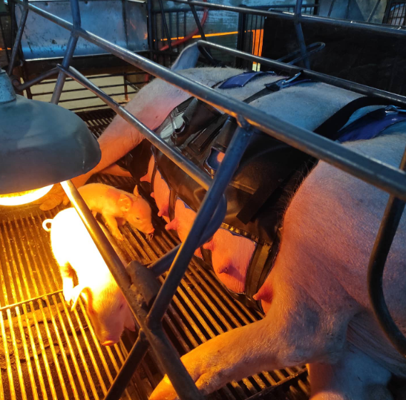
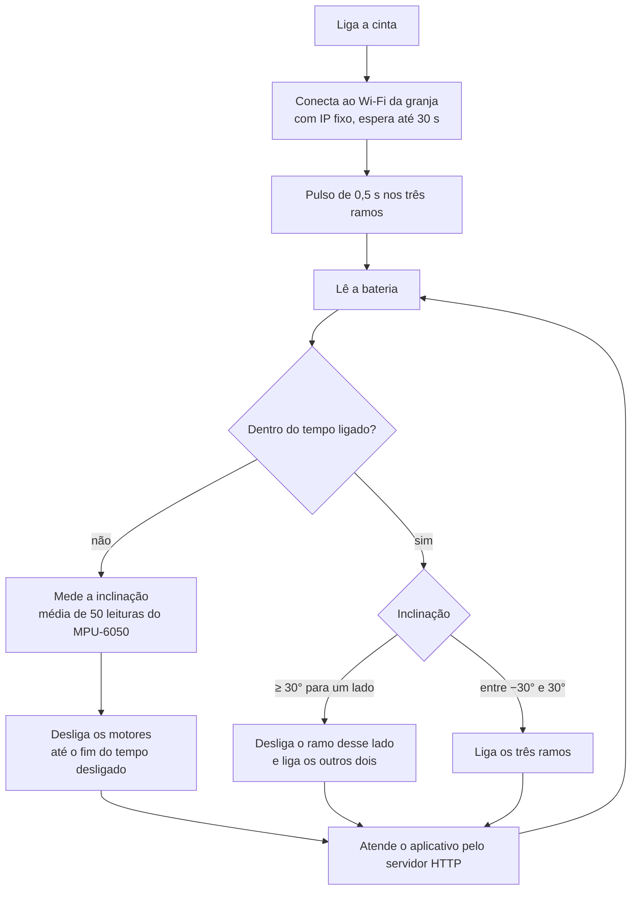
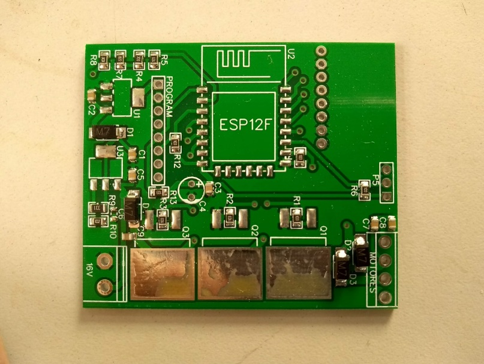
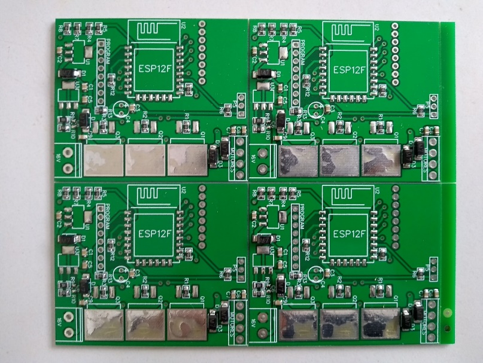
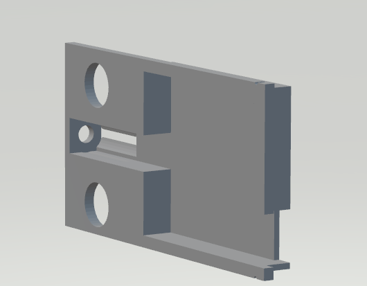
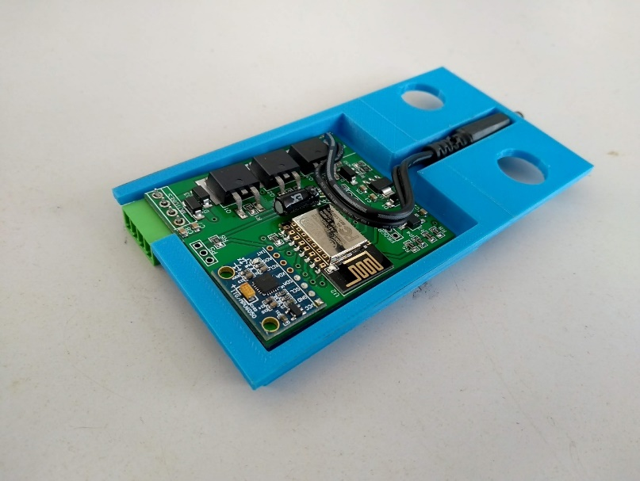
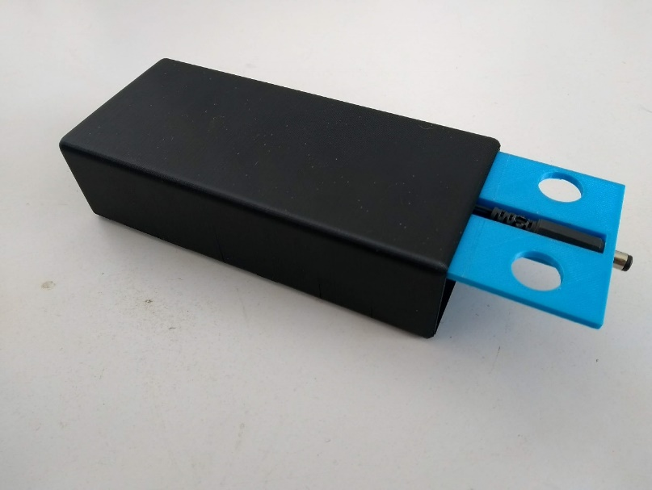
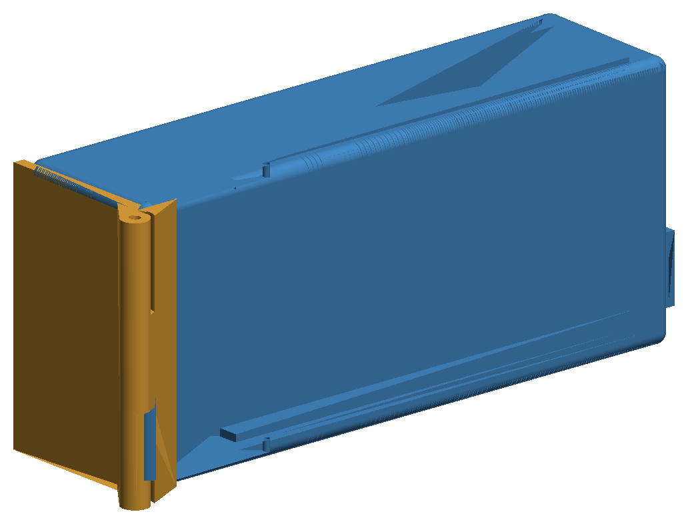

# PigSave, cinta massageadora para porcas com ESP8266

Durante meu estágio na Mars Tecnologia (Biopark, Toledo, PR, 2022), fiz parte da equipe que desenvolveu o PigSave. É uma cinta colocada nas porcas durante o parto, com motores que vibram para massagear a região mamária, estimular a produção de colostro e reduzir a natimortalidade dos leitões. O produto foi desenvolvido pela Mars Tecnologia em parceria com a PigMa Bem-Estar Animal e testado em granjas. Ajudei no projeto da placa, adaptei o firmware a partir de exemplos públicos de ESP8266 e do sensor MPU-6050, fabriquei e montei as placas e projetei sozinha a tampa com dobradiças do invólucro. Este repositório foi publicado com autorização da Mars Tecnologia.

> **English:** Firmware and 3D enclosure of PigSave, a vibrating massage belt for sows during farrowing, developed at Mars Tecnologia during my internship. An ESP8266 drives three branches of vibration motors through MOSFETs in on/off cycles, reads the belt tilt from an MPU-6050 to switch off the side branch when the sow lies on its side, and runs a small HTTP server with a JSON API used by an Android app.



*A cinta em uso numa granja. Foto da Mars Tecnologia.*

## O problema

Durante o parto, a massagem na região mamária ajuda a porca a liberar o colostro, o primeiro leite, que é essencial para os leitões nas primeiras horas. Nas granjas, isso depende de parteiros, que nem sempre conseguem acompanhar todas as porcas ao mesmo tempo. A cinta faz essa massagem de forma automática, em ciclos, e precisa ser leve, segura e fácil de colocar, porque é manuseada dentro das baias.

## Como funciona

A cinta tem três ramos de motores de vibração (esquerdo, central e direito). O firmware liga os três durante um tempo e desliga durante outro, em ciclos, e usa a inclinação da cinta para não acionar o ramo do lado em que a porca está deitada.



Os tempos padrão são 10 s ligado e 30 s desligado, e podem ser alterados pelo aplicativo. A cinta também funciona sem Wi-Fi, só com o ciclo de tempo. As duas versões estão no mesmo código e a escolha é feita no `platformio.ini`.

## Hardware

<table>
  <tr>
    <td></td>
    <td></td>
  </tr>
  <tr>
    <td align="center"><i>Placa montada</i></td>
    <td align="center"><i>Painel de placas, como chega da fábrica</i></td>
  </tr>
</table>

A placa foi projetada no EasyEDA. Os primeiros protótipos foram feitos à mão e, depois de aprovados, as placas foram fabricadas na China em painéis destacáveis. Uma empresa soldou a maior parte dos componentes, e o restante foi soldado à mão na Mars.

| Função | Componente |
|---|---|
| Controle e Wi-Fi | Módulo ESP-12F (ESP8266) |
| Inclinação | Acelerômetro e giroscópio GY-521 (MPU-6050), por I²C |
| Acionamento dos motores | 3 MOSFETs IRL520S (D2PAK), um por ramo |
| Saídas | Conectores KF15EDG-3.5 (comum, esquerdo, central e direito) |
| Motores | Motores CC de 3 V com massa excêntrica |
| Alimentação | Bateria de 12 V, com medição de carga pelo ADC |
| Gravação | Barramento para adaptador USB-serial |

| Pino | Uso |
|---|---|
| GPIO12 | Ramo esquerdo |
| GPIO14 | Ramo central |
| GPIO16 | Ramo direito |
| A0 | Tensão da bateria |
| GPIO4 e GPIO5 | I²C do MPU-6050 |

## API HTTP

Na versão com Wi-Fi, cada cinta tem um IP fixo na rede da granja e um nome, e o aplicativo Android da Mars conversa com ela pela porta 80.

| Requisição | O que faz |
|---|---|
| `GET /GetDados` | Retorna um JSON com tempo ligado, tempo desligado, estado, final do IP, nome, ângulo e bateria (%) |
| `GET /tonNNN` | Define o tempo ligado em NNN segundos |
| `GET /tofNNN` | Define o tempo desligado em NNN segundos |
| `GET /ON` | Liga a cinta e reinicia o ciclo |
| `GET /OFF` | Desliga os motores |

Exemplo de resposta de `/GetDados`:

```json
{
  "Ton": "10000",
  "Toff": "30000",
  "status": true,
  "final do ip": "173",
  "nome": "9",
  "angle": 0,
  "bateria": "87"
}
```

## Invólucro 3D

A eletrônica fica num invólucro impresso em 3D e projetado no SolidWorks, com quatro peças. São a base, que vai presa à lona da cinta, a caixa da bateria, a tampa da caixa e a gaveta onde a placa desliza.

<table>
  <tr>
    <td></td>
    <td></td>
    <td></td>
  </tr>
  <tr>
    <td align="center"><i>Gaveta da placa no SolidWorks</i></td>
    <td align="center"><i>Placa encaixada na gaveta</i></td>
    <td align="center"><i>Conjunto impresso</i></td>
  </tr>
</table>

### Tampa com dobradiças

Na última versão em que trabalhei, projetei uma tampa com duas dobradiças para a extremidade do invólucro. Assim, a placa pode ser acessada para manutenção e regravação sem descolar a lona da caixa, como era preciso antes.



*Base do invólucro (azul) com a tampa e as dobradiças (laranja), renderizadas a partir dos arquivos STL.*

## Organização

| Pasta | Conteúdo |
|---|---|
| `firmware/` | Projeto PlatformIO, com o código em `src/main.cpp` e a configuração da cinta em `include/config.h` |
| `hardware/3d/involucro/` | As quatro peças do invólucro e a montagem, em SolidWorks e STL |
| `hardware/3d/tampa-com-dobradica/` | Tampa, dobradiças e base ajustada, em SolidWorks e STL. A base está só em SolidWorks, porque o STL dela passa de 25 MB |
| `docs/` | Fotos e imagens deste README |

## Como compilar

Requer o [PlatformIO](https://platformio.org/), pela extensão do VS Code ou pela linha de comando.

1. Em `firmware/include/config.h`, preencha a rede Wi-Fi da granja, o final do IP e o nome da cinta.
2. Conecte o adaptador USB-serial ao barramento de gravação da placa.
3. Grave a versão desejada.

```
cd firmware
pio run -e wifi -t upload    # com Wi-Fi e aplicativo
pio run -e auto -t upload    # só com o ciclo de tempo
```

Antes de publicar, organizei o código sem mudar a lógica usada nas granjas. Juntei as versões com e sem Wi-Fi, que eram dois arquivos quase iguais, tirei a senha da rede do código, removi trechos comentados e deixei todos os comentários em português.

## O que eu faria diferente hoje

- **Ângulo enviado ao aplicativo.** A API envia a variável `yAngle`, que nunca é calculada, então o aplicativo sempre recebe 0. O valor certo é `xAngle`, que é o usado no controle dos motores.
- **Conexão Wi-Fi.** O `WiFi.begin` é chamado duas vezes, a segunda sem a senha. Além disso, se a rede não conectar em 30 s, a cinta segue em frente sem tentar de novo e ainda imprime "WiFi connected." na serial.
- **Pausas que travam o programa.** O laço tem duas pausas de 1 s com `delay`, então o aplicativo pode esperar até 2 s por uma resposta. O certo seria controlar os tempos com `millis()`.
- **Configuração gravada no código.** IP e nome são definidos na compilação, então cada cinta precisa ser gravada com um arquivo diferente. Eu salvaria essa configuração na memória flash e faria a primeira configuração pelo próprio aplicativo.
- **Leitura das requisições.** O tempo é lido por posição fixa no texto da requisição, então só aceita exatamente três dígitos, e as rotas não têm nenhuma autenticação.
- **Bateria.** O mapeamento do ADC (600 a 1024) não bate com as faixas de tensão anotadas no próprio código. Eu calibraria o divisor de tensão com a bateria real.
- **Inclinação.** O ângulo vem de uma conversão empírica dos valores brutos do acelerômetro. Uma biblioteca do MPU-6050 com filtro complementar daria uma medida mais estável, e o giroscópio, que é lido mas não usado, entraria no cálculo.

---

Desenvolvido na Mars Tecnologia, com supervisão do Eng. Marcelo A. Hickmann e orientação do Prof. Dr. Alberto Yoshihiro Nakano (UTFPR). Mantido por **Isadora Fernanda Zappe Schmidt** · [LinkedIn](https://www.linkedin.com/in/isadora-fernanda)
